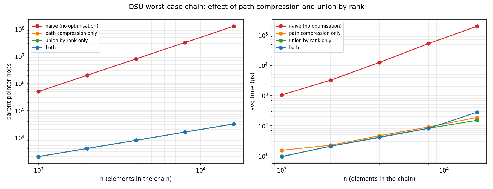
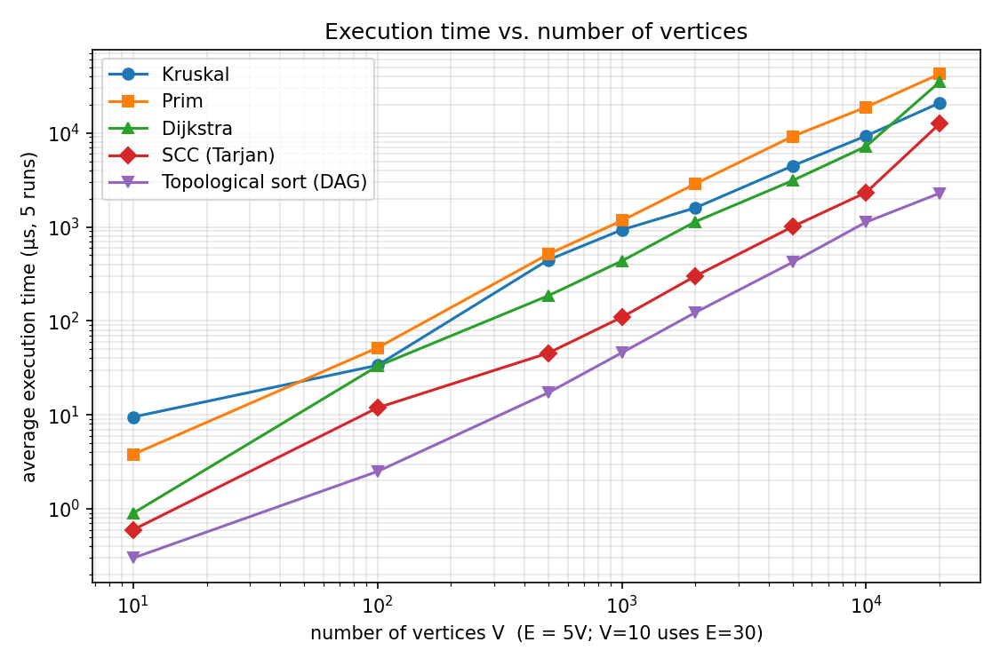
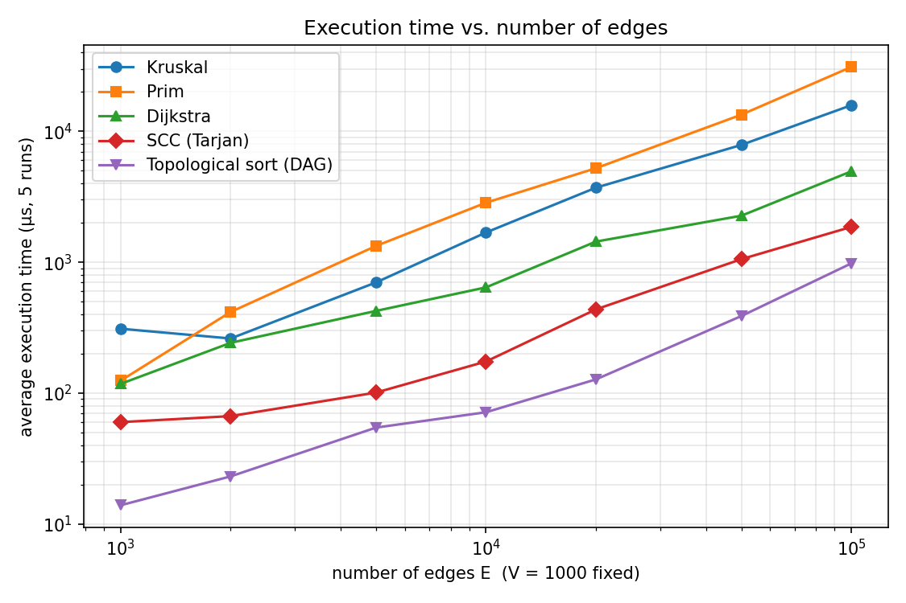
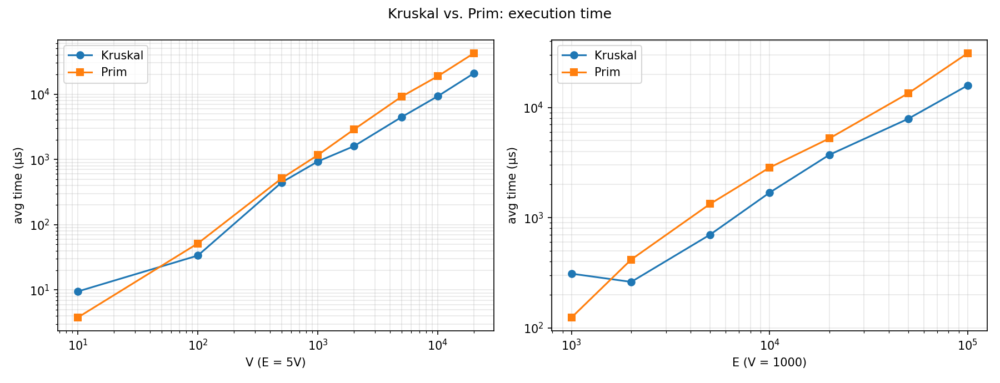
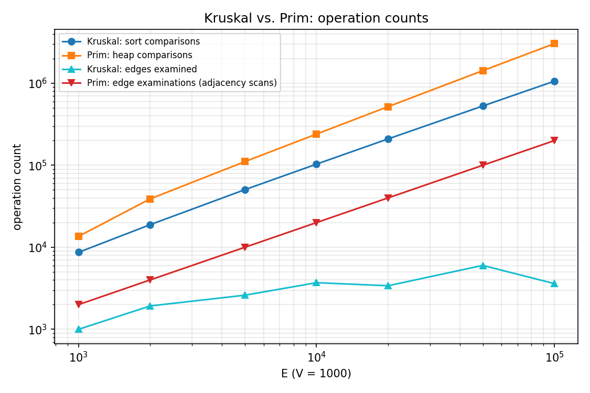
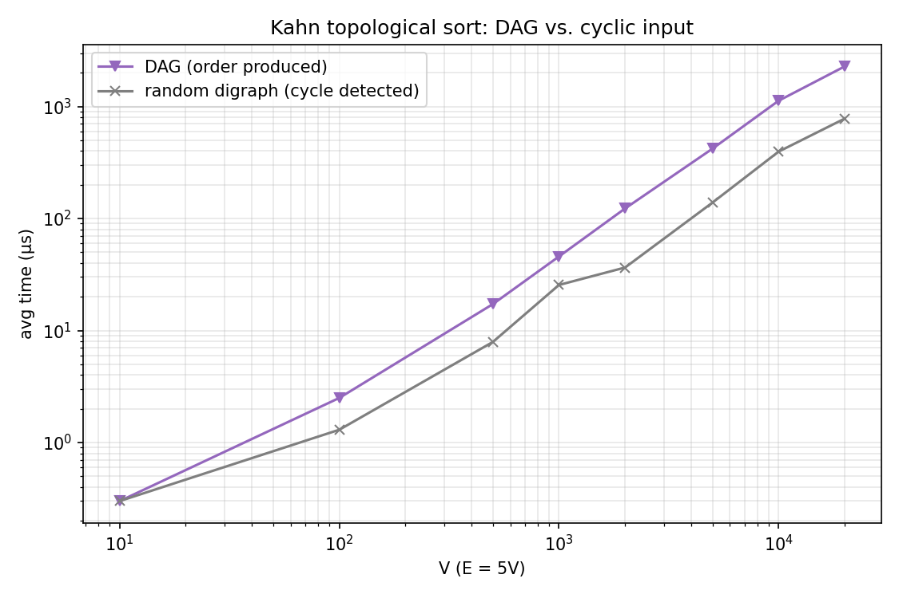
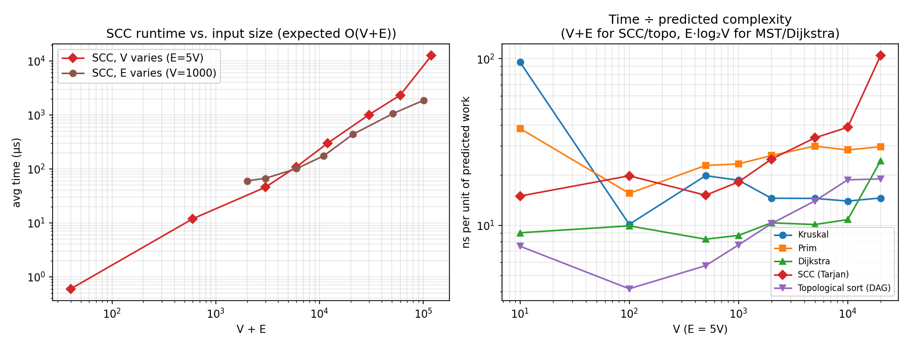
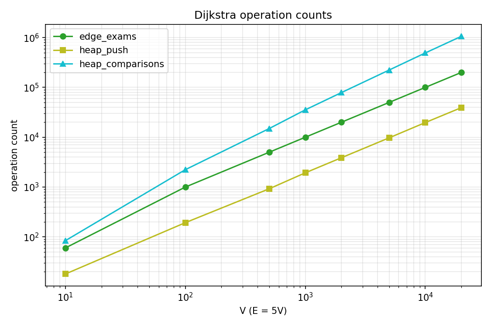

# Assignment 3 — Smart City Infrastructure and Route Planning

**Author:** Baktybay Nazar (SE-2530) · **Language:** Java 21, no external libraries · Python 3 + matplotlib only for drawing plots

A Java application that models a city as a weighted graph and solves three planning problems: the cheapest road network connecting all districts (**MST**), connectivity analysis of one-way streets and service dependencies (**topological order, SCC**), and shortest routes from a chosen district (**Dijkstra**). This README is the full report.

## Contents
1. [Overview](#1-overview) · 2. [Implementation](#2-implementation) · 3. [Complexity Analysis](#3-complexity-analysis) · 4. [Experimental Setup](#4-experimental-setup) · 5. [Results](#5-results) · 6. [Comparison and Discussion](#6-comparison-and-discussion) · 7. [Testing](#7-testing) · 8. [Conclusion](#8-conclusion) · 9. [How to run](#9-how-to-run)

---

## 1. Overview

Vertices are districts, edges are roads or infrastructure links, weights are construction costs (MST) or travel distances (shortest paths).

| Task | Graph | Algorithms |
|---|---|---|
| 1. Infrastructure planning | undirected, weighted | Kruskal + DSU, Prim + binary heap |
| 2. Connectivity | directed | Kahn topological sort, Tarjan SCC |
| 3. Route planning | non-negative weights | Dijkstra + binary heap |

**Graph representation.** `graph.Graph` stores an **adjacency list** plus a flat edge list. Vertices are `0..V-1`; `Edge` is an immutable `(from, to, weight)`. Undirected edges appear in both adjacency lists but once in the edge list (Kruskal sorts that list; Prim and Dijkstra walk adjacency lists). Space is `O(V + E)`. Adjacency lists suit the sparse test graphs (`E ≈ 3V–5V`) and every algorithm here scans neighbours.

```
assignment-3/
├── src/
│   ├── graph/          Graph, Edge, BinaryMinHeap, GraphGenerator (seeded)
│   ├── dsu/            DSU (path compression + union by rank)
│   ├── mst/            Kruskal, Prim, MSTResult
│   ├── connectivity/   TopologicalSort (Kahn), SCC (Tarjan)
│   ├── shortestpath/   Dijkstra
│   ├── app/            Demo, Experiments (benchmark driver)
│   └── tests/          TestRunner (291 checks)
├── results/
│   ├── tables/         CSV + Markdown tables
│   ├── plots/          PNG figures
│   └── test_output.txt
├── scripts/            build.sh, run_tests.sh, run_experiments.sh, plot.py
└── README.md
```

---

## 2. Implementation

* **Instrumented algorithms.** Each algorithm returns an `ops` map of exact, deterministic counters (edge examinations, comparisons, DSU `find`/`union` calls, parent hops, heap pushes/pops), so algorithms can be compared independently of timing noise.
* **DSU.** Array-based, **iterative** `find`. *Path compression* re-attaches visited nodes to the root; *union by rank* hangs the shallower tree under the deeper one. Each can be switched off for the ablation in §5.2. `union` returns `false` if both elements are already in one set, which Kruskal uses as its cycle test.
* **Kruskal.** Sorts a copy of the edge list, scans it with the DSU and **stops after `V-1` edges**. On a disconnected graph it returns a spanning forest and `connected = false`.
* **Prim.** Lazy-deletion binary heap (own `BinaryMinHeap`, so comparisons are counted). It restarts from every unvisited vertex, so it also returns a forest and the component count on disconnected graphs.
* **Topological order (Kahn).** Repeatedly removes in-degree-0 vertices. If fewer than `V` are removed, there is a cycle: `hasCycle = true`, `order = null`. `isValidOrder` independently verifies an order.
* **SCC (Tarjan), iterative.** Explicit call stack, so deep graphs do not overflow (tested on a 200,000-vertex path). Every vertex gets exactly one component id.
* **Dijkstra.** Binary heap with lazy deletion; `long` distances (`INF` = unreachable) and a parent array for `pathTo(v)`. **Negative weights are rejected** with an exception.
* **Graph generator.** Fixed-seed `java.util.Random`; simple graphs (no self-loops or parallel edges); integer weights in `[1, 100]`.

---

## 3. Complexity Analysis

**Assumptions:** adjacency lists, **binary heap** (`O(log n)` push/pop), comparison sort `O(E log E)`; for connected graphs `log E = Θ(log V)`; `α` = inverse Ackermann (`α(n) ≤ 4` in practice).

| Algorithm | Time | Extra space | How `V` and `E` affect it |
|---|---|---|---|
| DSU `find`/`union` (both optimisations) | `O(α(n))` amortised | `O(n)` | depends only on set count `n` |
| Kruskal | `O(E log V)` | `O(V + E)` | dominated by sorting `E` edges; `V` only via `log V` |
| Prim (binary heap) | `O(E log V)` | `O(V + E)` | `E` pushes/pops, each `O(log V)` |
| Topological sort (Kahn) | `O(V + E)` | `O(V)` | each vertex and edge handled once |
| SCC (Tarjan) | `O(V + E)` | `O(V)` | one DFS, each vertex and edge once |
| Dijkstra (binary heap) | `O((V + E) log V)` | `O(V + E)` | `≤ E+1` heap pushes; `E` adjacency scans |

**DSU.** Without optimisations unions can build a path of length `n`, so `find` costs `O(n)`. *Union by rank* keeps height `≤ log₂ n` (a tree of height `h` has `≥ 2^h` nodes). *Path compression* makes later finds on the same nodes almost free. Together they give `O(α(n))`. Kruskal makes `2E` finds and `≤ V-1` unions, so DSU work is `O(E·α(V))`, negligible next to the sort.

**Kruskal.** Sort `O(E log E)` + DSU `O(E·α(V))` = `O(E log V)`. The early exit skips heavy edges, but the sort still processes all `E`.

**Prim.** Each edge is pushed at most once, so `≤ E` pushes and `≤ E` pops, each `O(log E)`; scanning costs `O(V + E)`. Total `O(E log V)`. With a Fibonacci heap it is `O(E + V log V)`; a plain array gives `O(V²)`, which is better on very dense graphs.

**Kahn / Tarjan.** Both touch each vertex and each edge once: `O(V + E)` time, `O(V)` extra space. Kahn on a cyclic graph can stop early, but the in-degree pass over all edges is always paid.

**Dijkstra.** At most `E` successful relaxations, hence `≤ E+1` pushes at `O(log V)` each: `O((V + E) log V)`. In practice successful relaxations are far fewer than `E` (§6.5).

**Why Dijkstra fails with negative weights.** Dijkstra finalises a vertex when it is popped, assuming no later path can be shorter. That holds only if weights are `≥ 0`. Counter-example (also a test): `s→A (2)`, `s→B (5)`, `B→A (−4)`. `A` is popped first with distance 2 and finalised; later `s→B→A` costs `5 − 4 = 1`, but `A` is already final, so Dijkstra reports 2 instead of 1. With a negative cycle shortest paths are undefined. Use Bellman–Ford (`O(VE)`) or Johnson's algorithm instead.

---

## 4. Experimental Setup

| Graph | V | E |
|---|---|---|
| Small | 10 | 30 |
| Medium | 100 | 500 |
| Large | 1,000 | 5,000 |

For plots I also ran **series V** (`E = 5V`, `V` up to 20,000) and **series E** (`V = 1000`, `E` from 1,000 to 100,000); both contain the required sizes.

**Generation (reproducible).** Seed `42·1,000,003 + 10,007·V + 31·E + kind` (`kind`: 1 undirected, 2 directed, 3 DAG), so each `(V, E)` always gives the same graph. Weights are uniform integers in `[1, 100]`.
* **Undirected (MST, Dijkstra):** a random spanning tree is built first (**guarantees connectivity**), then random extra edges are added up to exactly `E`.
* **Directed (SCC, Dijkstra, cyclic topo input):** `E` distinct random ordered pairs. These graphs **contain cycles** (confirmed by Kahn for every size).
* **DAGs:** edges only from earlier to later vertices in a random permutation, so no cycle can exist.

**Measurement.** Graphs are generated outside the timed code. After a JVM warm-up, each algorithm runs **5 repetitions**; each repetition times a batch of back-to-back runs with `System.nanoTime()` and divides by the batch size. Tables show the **mean of the 5 repetitions** in µs. **Operation counts** are exact, from one instrumented run. The program aborts if Kruskal and Prim ever disagree on MST weight.

**Environment:** OpenJDK 21, Linux amd64, **1 CPU core**. Absolute times depend on the machine; trends and operation counts are what to compare.

---

## 5. Results

Times are average µs per execution. Full tables are in `results/tables/`.

### 5.1 Generated graphs

| V | E | undirected connected | directed has cycle | DAG has cycle | SCC count (directed) |
|---|---|---|---|---|---|
| 10 | 30 | true | true | false | 1 |
| 100 | 500 | true | true | false | 3 |
| 1000 | 5000 | true | true | false | 23 |

### 5.2 Kruskal vs. Prim

| V | E | Algorithm | avg µs | MST weight | edge exams | comparisons | DSU find / union | heap push / pop |
|---|---|---|---|---|---|---|---|---|
| 10 | 30 | Kruskal | 9.5 | 151 | 14 | 112 | 28 / 14 | - |
| 10 | 30 | Prim | 3.8 | 151 | 60 | 195 | - | 30 / 30 |
| 100 | 500 | Kruskal | 33.7 | 1294 | 237 | 3,826 | 474 / 237 | - |
| 100 | 500 | Prim | 51.7 | 1294 | 1,000 | 7,715 | - | 500 / 500 |
| 1000 | 5000 | Kruskal | 929.8 | 12715 | 2,604 | 50,390 | 5,208 / 2,604 | - |
| 1000 | 5000 | Prim | 1164.9 | 12715 | 10,000 | 110,696 | - | 5,000 / 5,000 |

Both algorithms return the same weight in every configuration. (`edge exams`: Kruskal = edges taken before stopping; Prim = adjacency entries scanned, always `2E`.)

### 5.3 DSU — path compression and union by rank

Kruskal with four DSU variants (`path hops` = parent-pointer steps in the whole run):

| V | E | Variant | avg µs | path hops |
|---|---|---|---|---|
| 1000 | 5000 | naive | 1832.6 | 401,772 |
| 1000 | 5000 | path compression only | 1143.9 | 10,329 |
| 1000 | 5000 | union by rank only | 749.1 | 7,258 |
| 1000 | 5000 | both | 996.7 | 4,668 |

Adversarial chain test (`n` unions `union(i+1, i)`, then one `find` per element):

| n | naive µs / hops | compression only µs / hops | rank only µs / hops | both µs / hops |
|---|---|---|---|---|
| 1,000 | 1047 / 499,500 | 15.4 / 1,997 | 9.5 / 1,996 | 9.6 / 1,996 |
| 4,000 | 12,540 / 7,998,000 | 46.9 / 7,997 | 42.4 / 7,996 | 41.0 / 7,996 |
| 16,000 | 197,608 / 127,992,000 | 189.2 / 31,997 | 151.9 / 31,996 | 281.5 / 31,996 |



### 5.4 Scaling (series V, `E = 5V`), µs

| V | E | Kruskal | Prim | Dijkstra | SCC | Topo (DAG) |
|---|---|---|---|---|---|---|
| 10 | 30 | 9.5 | 3.8 | 0.9 | 0.6 | 0.3 |
| 100 | 500 | 33.7 | 51.7 | 33.0 | 11.9 | 2.5 |
| 1000 | 5000 | 929.8 | 1164.9 | 433.9 | 109.3 | 45.8 |
| 5000 | 25000 | 4459.0 | 9180.7 | 3109.7 | 1004.8 | 420.2 |
| 10000 | 50000 | 9298.7 | 18812.8 | 7193.9 | 2326.2 | 1125.8 |
| 20000 | 100000 | 20855.6 | 42382.5 | 34859.2 | 12513.4 | 2280.5 |

Series E (`V = 1000`), µs:

| E | Kruskal | Prim | Dijkstra | SCC | Topo (DAG) |
|---|---|---|---|---|---|
| 1000 | 310.3 | 124.4 | 117.6 | 60.0 | 13.9 |
| 5000 | 700.6 | 1331.1 | 424.5 | 100.9 | 54.5 |
| 20000 | 3712.0 | 5226.9 | 1437.6 | 436.2 | 127.3 |
| 100000 | 15833.7 | 31045.5 | 4946.5 | 1861.6 | 979.6 |

**Required plots**

Execution time vs. number of vertices (`E = 5V`, log–log):



Execution time vs. number of edges (`V = 1000`, log–log):



Additional plots:




### 5.5 Topological ordering — DAGs and graphs with cycles

| V | E | Input | avg µs | has cycle | ordered vertices | order valid | edge exams |
|---|---|---|---|---|---|---|---|
| 10 | 30 | DAG | 0.3 | false | 10 | true | 60 |
| 10 | 30 | random digraph | 0.3 | true | 0 | n/a | 30 |
| 100 | 500 | DAG | 2.5 | false | 100 | true | 1000 |
| 100 | 500 | random digraph | 1.3 | true | 2 | n/a | 507 |
| 1000 | 5000 | DAG | 45.8 | false | 1000 | true | 10000 |
| 1000 | 5000 | random digraph | 25.5 | true | 5 | n/a | 5027 |



### 5.6 Strongly connected components

| V | E | avg µs | components | largest SCC | edge exams |
|---|---|---|---|---|---|
| 10 | 30 | 0.6 | 1 | 10 | 30 |
| 100 | 500 | 11.9 | 3 | 98 | 500 |
| 1000 | 5000 | 109.3 | 23 | 978 | 5000 |
| 5000 | 25000 | 1004.8 | 68 | 4933 | 25000 |
| 20000 | 100000 | 12513.4 | 255 | 19746 | 100000 |



### 5.7 Dijkstra

| V | E | Graph | avg µs | reachable | edge exams | successful relaxations | heap push / pop | heap comparisons |
|---|---|---|---|---|---|---|---|---|
| 10 | 30 | undirected | 0.9 | 10 | 60 | 17 | 18 / 18 | 84 |
| 10 | 30 | directed | 1.2 | 10 | 30 | 14 | 15 / 15 | 53 |
| 100 | 500 | undirected | 33.0 | 100 | 1,000 | 192 | 193 / 193 | 2,234 |
| 100 | 500 | directed | 13.8 | 98 | 493 | 131 | 132 / 132 | 1,275 |
| 1000 | 5000 | undirected | 433.9 | 1000 | 10,000 | 1,931 | 1,932 / 1,932 | 35,464 |
| 1000 | 5000 | directed | 372.3 | 995 | 4,973 | 1,401 | 1,402 / 1,402 | 23,176 |

Unreachable vertices (e.g. 98 of 100 reachable in the directed graph) are reported as `INF` with no path.



---

## 6. Comparison and Discussion

### 6.1 Kruskal vs. Prim
* Weights are identical in all configurations; only cost differs. Both are `O(E log V)`: time divided by `E·log₂V` stays roughly constant (Kruskal ≈ 10–20 ns, Prim ≈ 23–30 ns for `V ≥ 500`), so they differ by a constant factor.
* On `V = 1000`, `E = 100,000`, Kruskal sorts (~1.06 M comparisons) but examines only **3,607 edges** (3.6 %) before the tree is complete. Prim does `2E` scans, `E` pushes/pops and ~3.04 M heap comparisons (about 3× more), because its lazy heap fills with entries discarded later. Time: 15.8 ms vs 31.0 ms.
* Sparse and tiny graphs favour Prim (`V = E = 1000`: 124 µs vs 310 µs), because Kruskal's sort overhead matters more than a short heap run.
* **Noise:** `V=1000, E=5000` was measured twice (Kruskal 930 vs 701 µs, Prim 1165 vs 1331 µs), so differences under ~30 % are not significant; the ≈2× gaps at large `E` are.

### 6.2 DSU optimisations
* On the Large graph, hops fall from **401,772** (naive) to 10,329 (compression), 7,258 (rank) and **4,668** (both), an 86× reduction (≈ 0.9 hops per `find`).
* On the adversarial chain with `n = 16,000`, naive does **127,992,000** hops (`≈ n²/2`, quadratic: 4× when `n` doubles), while the others need ≈ `2n` hops (linear) and run about **1000× faster**. Either optimisation alone removes the quadratic behaviour; together they give the fewest hops on random graphs.
* Inside Kruskal the sort dominates, so end-to-end times of the four variants are close and noisy; hop counts are the reliable evidence.

### 6.3 Topological ordering
* All random DAGs give a valid order; all random digraphs are detected as cyclic.
* Cyclic inputs are cheaper because with `E = 5V` almost no vertex has in-degree 0, so Kahn's queue empties after 0–5 vertices (25.5 µs vs 45.8 µs at `V=1000`). The in-degree pass over all edges is paid either way. Operation counts match `O(V + E)` (`edge_exams = 2E` for DAGs).

### 6.4 SCC scaling
* Operation counts are exactly linear: `edge_exams = E` and each vertex is visited once.
* Time grows slightly faster than linearly: from about 15 ns per unit of `V+E` (`V ≤ 1000`) to ≈ 100 ns (`V = 20,000`). Since the counted work is exactly linear, I **hypothesise** the extra cost is memory locality (separately allocated `Edge` objects, random targets) plus single-core noise; I did not profile to confirm this.
* At `V = 1000`, increasing `E` from 1,000 to 100,000 raises time from 60 µs to 1.86 ms. Structure: `E=1000` → 977 components; `E=5000` → 23 (largest 978); `E ≥ 10,000` → one SCC. A giant SCC appears once average out-degree exceeds 1.

### 6.5 Dijkstra
* Undirected graphs: edge examinations `= 2E`, pushes = successful relaxations + 1, about 48 % of pops are stale at `V = 1000`.
* The `E log V` bound is pessimistic: with `V = 1000` and `E` rising 100×, successful relaxations rise only ~4× (1,000 → 4,152) and heap comparisons ~7×, while time rises 42× (117 µs → 4.95 ms), driven mostly by scanning `2E` adjacency entries.
* Directed graphs are cheaper (`E` instead of `2E` examinations) and have unreachable vertices, which do not affect correctness.

### 6.6 Theory vs. experiment

| Algorithm | Predicted | Observed |
|---|---|---|
| Kruskal | `O(E log V)` | normalised time roughly constant; early exit examines 3.6 %–100 % of edges depending on density |
| Prim | `O(E log V)` | roughly constant per `E·log₂V`; exactly `E` pushes/pops; ~3× Kruskal's comparisons on dense graphs |
| Kahn | `O(V + E)` | operation count exactly linear |
| Tarjan SCC | `O(V + E)` | operations exactly linear; time per unit rises ~7× over 3 orders of magnitude |
| Dijkstra | `O(E log V)` | scans `2E`, heap work grows much slower than `E` |
| DSU | `O(α(n))` | ≈ 0.9 hops per find; ≈ 2 hops per element on the chain vs `n/2` naive |

**Limitations:** one CPU core, JIT/GC noise, one seed per configuration, one JVM run. Operation counts are the more robust basis for comparison.

---

## 7. Testing

`./scripts/run_tests.sh` runs **291 checks, 0 failures** (log in `results/test_output.txt`), using hand-checked graphs and random graphs compared against brute-force oracles.

| Required category | What is tested |
|---|---|
| Small graphs | textbook 4/5-vertex MSTs, triangle with one heavy edge, textbook Dijkstra, DAG and SCC graphs |
| Disconnected graphs | 3 components incl. an isolated vertex: both MSTs report `connected = false`, 3 components, forest weight 8; graph with no edges |
| Graphs with cycles | triangle MST drops the heavy edge; Kahn detects a 3-cycle, a self-loop, and cycles injected into 300 random DAGs |
| Multiple valid MSTs | equal-weight 4-cycle, K4 with equal weights (16 MSTs): Kruskal and Prim give the same weight and `V-1` edges |
| Unreachable vertices | Dijkstra gives `INF` and empty path; one-way roads are not traversable backwards |
| Duplicate weights | random graphs with weights in `{1..k}`, parallel edges, ties in Dijkstra |
| Single vertex | MST (weight 0, connected), topological sort `[0]`, SCC (1 component), Dijkstra (distance 0), DSU |

**Correctness checks**
* Kruskal == Prim on 300 tiny random graphs (vs. brute force over all edge subsets), 200 more random graphs, and the benchmark sizes.
* Topological order valid for 300 random DAGs (checked with `isValidOrder`); every injected cycle detected (`order = null`).
* Every vertex is in exactly one SCC; Tarjan matches a reachability (transitive closure) oracle on 300 random digraphs; a 200,000-vertex path causes no stack overflow.
* Dijkstra matches **Bellman–Ford** on 400 random graphs; reconstructed paths sum to the reported distance.
* Negative weights are rejected; the unguarded variant returns 2 instead of the true 1 on the §3 counter-example.
* Same seed gives an identical graph; different seeds differ.

---

## 8. Conclusion

* **MST.** Kruskal and Prim always return the same weight. Kruskal was ≈ 2× faster on large and dense graphs because it sorts once and stops after `V-1` edges, while Prim's lazy heap handles every edge. Prim was faster on very sparse and tiny graphs. Use Kruskal when edges are given as a list and the graph is large or dense; use Prim on sparse adjacency structures (an indexed heap or `O(V²)` array version for dense ones).
* **DSU.** Path compression and union by rank each remove the quadratic worst case; together they give ≈ `α(n)` behaviour (~1000× less work than naive on a chain). Implement both.
* **Connectivity.** Kahn's algorithm orders dependencies (e.g. service start-up) and detects cycles in `O(V+E)`; Tarjan's SCC finds mutually reachable zones of one-way networks in one `O(V+E)` pass.
* **Shortest paths.** Dijkstra with a binary heap is right for non-negative distances; never use it with negative weights (use Bellman–Ford or Johnson).
* **Lesson.** Asymptotic classes predicted growth correctly, but constants (sorting vs. heap, scanning, memory locality) decided which algorithm was faster; operation counters were more reliable than wall-clock time on a noisy single-core machine.

---

## 9. How to run

Requires JDK 17+ (developed with 21); Python 3 with matplotlib only for plots.

```bash
./scripts/build.sh            # compile to out/
./scripts/run_tests.sh        # 291 checks, exit code 1 on failure
java -cp out app.Demo         # smart-city example for all three tasks
./scripts/run_experiments.sh  # runs all experiments (~2-3 min), rewrites results/tables and results/plots
```

Graphs, operation counts and MST weights are identical on every run (fixed seeds); only wall-clock times vary.
